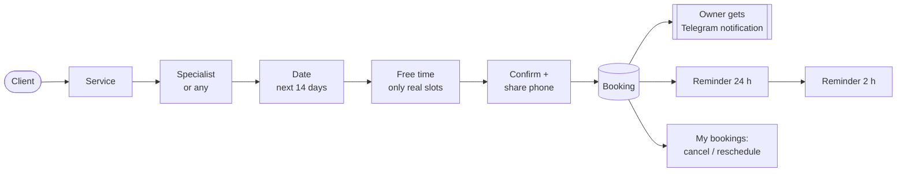
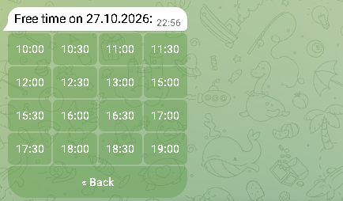
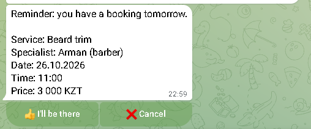
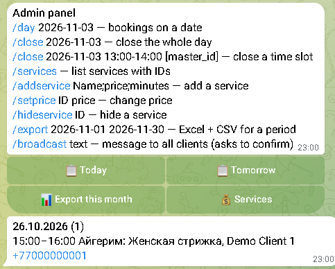

# Telegram Booking Bot

**Telegram booking bot for salons, barbers and tutors — clients book 24/7, you get notified instantly.**

[](https://github.com/zhangir777/telegram-booking-bot/actions/workflows/ci.yml)

**Hire me:** [Upwork](https://www.upwork.com/freelancers/~012c68804f9b4d4550) · [Fiverr](https://www.fiverr.com/akhmetov_zhangi) · [Telegram @ZhangirAkhmetov](https://t.me/ZhangirAkhmetov)

> **Try the demo:** TODO — link to the demo bot. The demo uses the fictional business “Demo Beauty Almaty”; all names, phones and bookings are made up.



| Menu | Free time | Confirm |
|---|---|---|
|  |  |  |
| **Reminder** | **Admin panel** | |
|  |  | |

*Screenshots from the live demo bot in Telegram Web, demo data.*

## What your clients get
- Book in 5 taps: service → specialist (or “any”) → date → free time → confirm
- Only real free time is shown: work hours, lunch break, service length and existing bookings are taken into account. **Double booking is impossible** (checked in a transaction, covered by tests)
- “My bookings”: cancel or reschedule in one tap
- Reminders 24 h and 2 h before the visit with “I’ll be there” / “Cancel” buttons
- Prices, address with map pin, FAQ
- Russian, Kazakh and English

## What you (the owner) get
- Instant Telegram notification for every new booking, cancellation and reschedule
- `/admin`: today’s and tomorrow’s bookings, any date
- Close a day or a time slot (day off, lunch, holiday)
- Add services and change prices without touching code
- Broadcast to all clients (with preview and Telegram rate limits)
- Export bookings for any period to Excel and CSV

## How I adapt it to your business (1–2 days)
I need from you: list of services with prices and duration, specialists and their schedule, address, phone, 3–5 FAQ answers, preferred languages.
Then: your branding and texts → deploy on a server → you test → launch. Support from 10 000 ₸/month.

## Privacy
The bot stores only what is needed: Telegram id, name, phone (shared by the client with a button), language and bookings.
A client can delete all their data with `/deletemydata`. Data stays on your server (SQLite file), nothing is sent to third parties.

---

## Technical

Python 3.12, aiogram 3, SQLAlchemy 2 (async) + SQLite (WAL), APScheduler, pydantic-settings, Docker.

```bash
cp .env.example .env          # BOT_TOKEN from @BotFather, ADMIN_IDS=[your id]
uv sync
uv run seed-demo              # optional demo data
uv run python -m bot.main
uv run pytest -q              # 34 offline tests, no Telegram needed
```

| Path | What |
|---|---|
| `bot/services/` | business logic without aiogram: slots, bookings, reminders, export |
| `bot/handlers/client`, `bot/handlers/admin` | Telegram handlers |
| `bot/middlewares/` | user language, admin-only access, anti-flood |
| `bot/locales/*.yaml` | all texts (Kazakh needs review by a native speaker) |
| `business.yaml` | name, address, map pin, hours, FAQ — edit per client |
| `template/` | lightweight FAQ + lead bot for small orders |
| `deploy/DEPLOY.md` | VPS deploy, auto-restart, daily backups, updates |

Docker: `docker compose up -d --build`. Details in [deploy/DEPLOY.md](deploy/DEPLOY.md).

## На русском

Бот записи для салонов, барбершопов и репетиторов. Клиенты записываются сами 24/7, без переписки в WhatsApp и директе, а вы сразу получаете уведомление в Telegram.

- Запись: услуга → мастер → дата → свободное время → подтверждение. Двойная запись невозможна.
- Напоминания клиентам за 24 и 2 часа, отмена и перенос в один клик.
- Админка прямо в Telegram: записи на день, закрыть день/время, цены, рассылка, выгрузка в Excel.
- Русский, казахский, английский.

Адаптирую под ваш бизнес за 1–2 дня: нужны услуги с ценами, мастера и график, адрес и ответы на частые вопросы. Бот записи — 40–80 тыс. ₸, поддержка — от 10 тыс. ₸/мес. Демо в этом репозитории — вымышленный салон «Demo Beauty Almaty».
